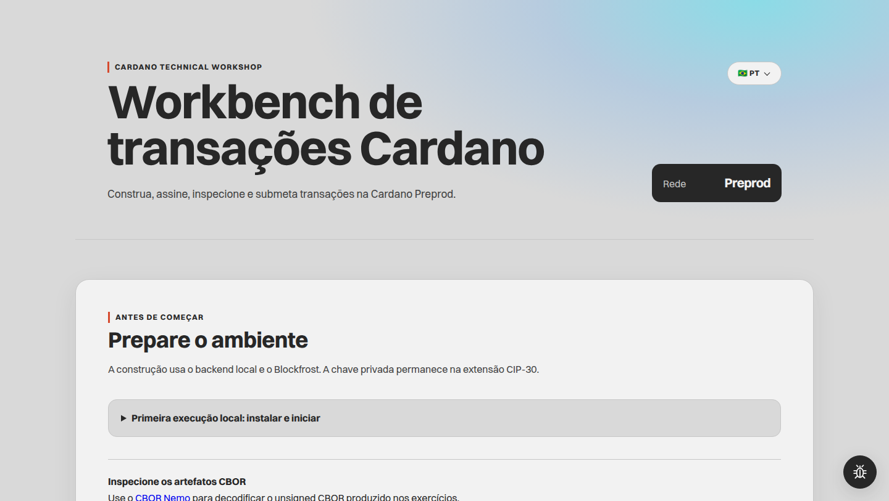

# Cardano Transaction Workbench

[](https://github.com/linconvidal/cardano-technical-workshop/actions/workflows/validation.yml)
[](https://github.com/linconvidal/cardano-technical-workshop/actions/workflows/vercel.yml)

[Versão em português](README.md)

Learn to build Cardano transactions step by step, inspect their data, and sign them with your wallet.

[Open the Workbench](https://cardano-technical-workshop.vercel.app/)



## Get started

Use a CIP-30-compatible wallet configured for **Preprod** and a [Blockfrost](https://blockfrost.io/) API key for that network. You can get tADA, the test currency, from the [faucet](https://docs.cardano.org/cardano-testnets/tools/faucet).

In the Workbench, choose **API key**, enter your Blockfrost key, and connect your wallet. Follow the steps in the interface. Never enter your seed phrase or private key in the Workbench.

## Run locally

Requires Node.js 20.19 or newer.

```bash
git clone https://github.com/linconvidal/cardano-technical-workshop.git
cd cardano-technical-workshop
npm ci
cp .env.example .env
```

Set `BLOCKFROST_PROJECT_ID` in `.env` to your Preprod key. Then:

```bash
npm run dev
```

Open <http://127.0.0.1:5173>.

## CLI

To use the examples from the terminal, see the available commands and configuration:

```bash
npm run start -- --help
```

Supporting material: [facilitation guide](passoapasso.en.md).

## License

[MIT](LICENSE).
