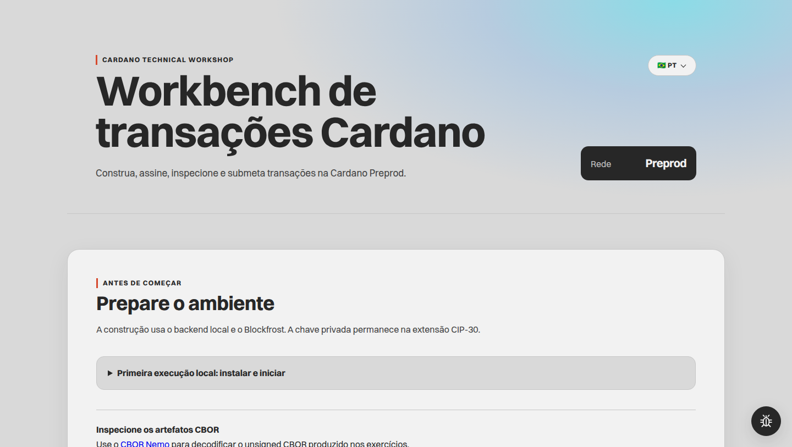

# Cardano Transaction Workbench

[](https://github.com/cardano-foundation/cardano-technical-workshop/actions/workflows/validation.yml)
[](https://github.com/cardano-foundation/cardano-technical-workshop/actions/workflows/vercel.yml)

[English version](README.en.md)

Aprenda a construir transações Cardano passo a passo, inspecionar seus dados e assiná-las com sua carteira.

[Abrir a Workbench](https://cardano-technical-workshop.vercel.app/)



## Começar

Use uma carteira compatível com CIP-30, configurada para **Preprod**, e uma chave de API [Blockfrost](https://blockfrost.io/) para essa rede. Você pode obter tADA, a moeda de teste, no [faucet](https://docs.cardano.org/cardano-testnets/tools/faucet).

Na Workbench, clique em **API key**, informe a chave Blockfrost e conecte sua carteira. Siga as etapas apresentadas na interface. Nunca informe sua seed phrase ou chave privada na Workbench.

## Rodar localmente

Requer Node.js 20.19 ou superior.

```bash
git clone https://github.com/cardano-foundation/cardano-technical-workshop.git
cd cardano-technical-workshop
npm ci
cp .env.example .env
```

Preencha `BLOCKFROST_PROJECT_ID` no `.env` com sua chave de Preprod. Depois:

```bash
npm run dev
```

Abra <http://127.0.0.1:5173>.

## CLI

Para usar os exemplos pelo terminal, consulte os comandos e a configuração necessária:

```bash
npm run start -- --help
```

Material de apoio: [roteiro de facilitação](passoapasso.md).

## Licença

[MIT](LICENSE).
